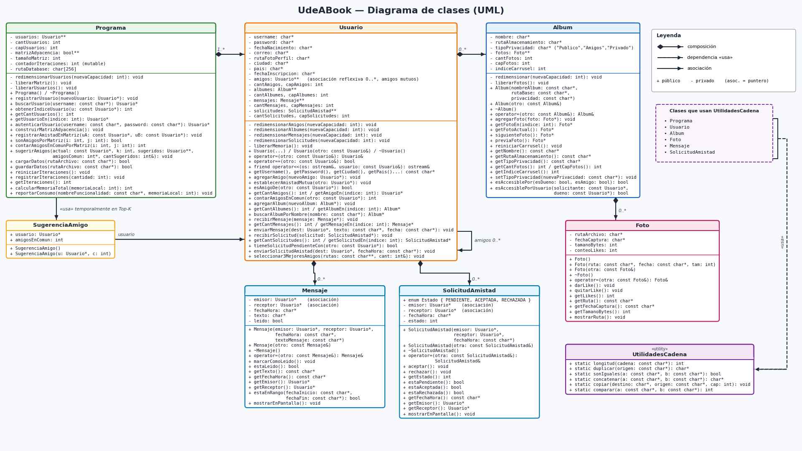

# UdeABook

UdeABook es una aplicacion de red social por consola desarrollada en C++ para el Desafio II de la materia Informatica II. El proyecto permite simular las funciones principales de una red social mediante un menu interactivo en el que cada usuario puede iniciar sesion y administrar su cuenta.

Dentro del sistema, los usuarios pueden agregar amigos, enviar y responder solicitudes de amistad, y recibir sugerencias de nuevas conexiones basadas en los amigos que tienen en comun. Tambien cuenta con un apartado de mensajeria para enviar mensajes a otros contactos, revisar los mensajes pendientes y buscar conversaciones por fechas, ademas de una seccion para seleccionar a los tres mejores amigos.

Por otra parte, la aplicacion permite crear albumes de fotos con diferentes niveles de privacidad (publico, solo amigos o privado), navegar por las fotos mediante un carrusel y dar me gusta a las publicaciones. Toda la informacion se carga y se guarda en un archivo de texto para conservar los cambios realizados, mostrando al final de cada operacion el uso de memoria y la cantidad de pasos ejecutados por el programa.

## Arquitectura del sistema

## Video demostrativo y sustentacion

Enlace al video explicativo y sustentacion del funcionamiento:
https://youtu.be/WwCKyS2_4?si=PxpKW6nYdM2Yo79

## Informe de desarrollo

https://docs.google.com/document/d/1qsGeKGSFRQnRxSknX9JTZq-JwdP1d39e/edit
